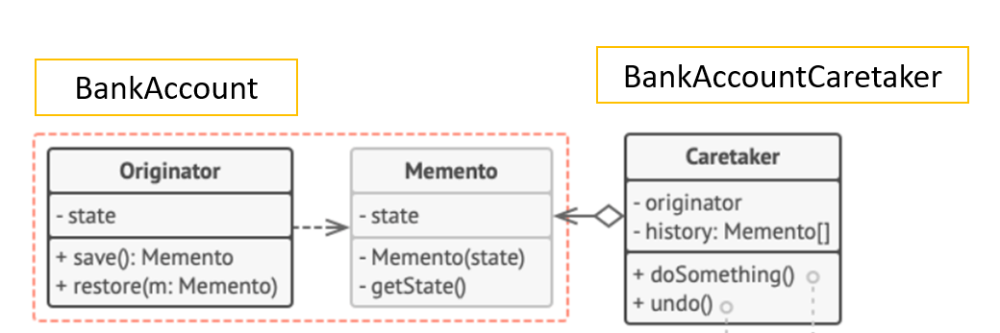

# A4.5 — Padrão Memento

**Tópicos Avançados de POO · 2026/27**

O projeto aplica o padrão **Memento** à gestão do estado de uma conta bancária. A classe `BankAccount` cria e restaura os seus estados, enquanto `BankAccountCaretaker` guarda os Mementos numa pilha e permite recuperar o último estado guardado. O exemplo base está implementado; a recuperação de estados por data e a inclusão dos movimentos serão desenvolvidas pelos estudantes.

A classe **`Movement` é fornecida**, mas só será integrada na conta e nos Mementos na atividade 2. Na atividade 1, mantém-se o estado da conta limitado ao saldo.


## Executar o projeto

Abra o `pom.xml` no IntelliJ IDEA, carregue o projeto Maven e selecione um JDK 17 ou superior. Execute o método `main` da classe `Main`, sem argumentos.

Se tiver Maven disponível no terminal:

```bash
mvn compile
mvn exec:java
```

As atividades estão por resolver. Os comentários `TODO` identificam os pontos a adaptar; o exemplo base compila e executa antes dessas alterações.

## Modelo inicial



## Atividade preparatória — Explorar o exemplo

Execute o `Main` e observe os saldos apresentados antes e depois do undo. Analise as classes fornecidas e o diagrama UML e responda às seguintes questões:

1. Quais são os participantes do padrão Memento nas classes fornecidas? Indique a classe correspondente a cada participante e a sua responsabilidade.
2. Que informação é guardada num Memento? Por que motivo não é necessário guardar `accountHolder` neste exemplo?
3. Como consegue o gestor recuperar um estado da conta sem conhecer o significado dos dados guardados no Memento?
4. Em que momentos é chamado `save()` no `Main`? Explique por que motivo o undo recupera o saldo 1500 e não o saldo inicial 1000.
5. Qual é a diferença entre desfazer uma transação através do padrão Command e recuperar um estado através do padrão Memento?

## Atividade 1 — Recuperar estados por data

**Problema:** a pilha permite recuperar apenas o estado guardado mais recentemente. Pretende-se poder escolher um dos estados guardados através da sua data de captura.

**Requisitos:**

- Substituir a `Stack<BankAccount.Memento>` de `BankAccountCaretaker` por um `Map<Date, BankAccount.Memento>`, implementado com **`java.util.HashMap`**.
- Adaptar `save()` para associar cada Memento à data e hora da sua captura, utilizando **`java.util.Date`**. O método deve devolver uma cópia da data utilizada como chave, com o mesmo valor, para permitir selecionar esse estado posteriormente.
- Acrescentar `Collection<Date> getSavedDates()` para consultar as datas com estados disponíveis.
- Substituir `undo()` por **`void restore(Date date)`**, que recupera exatamente o estado associado à data indicada.
- Restaurar um estado não deve removê-lo do mapa nem eliminar os restantes estados. Deve ser possível voltar a recuperar qualquer um deles.
- Se a data for nula ou não existir no histórico, lançar `IllegalArgumentException`, sem alterar a conta nem os estados guardados.

**Atenção:** um `HashMap` não garante uma ordem cronológica. A recuperação deve utilizar uma das datas devolvidas por `save()` ou `getSavedDates()`, e não depender da posição dos elementos na coleção.

**Pistas de implementação — datas e proteção das chaves:**

1. **Criar uma data em cada captura.** Dentro de `save()`, crie uma nova instância com `new Date()`. Não reutilize uma data criada no construtor do gestor.
2. **Evitar chaves repetidas.** `Date` representa o tempo em milissegundos: duas chamadas rápidas podem produzir datas iguais. Antes de inserir, consulte `mementos.containsKey(date)`. Enquanto a chave já existir, avance a data candidata um milissegundo. Faça esse ajuste **antes de inserir a chave**:

   ```java
   Date date = new Date();
   while (mementos.containsKey(date)) {
       date.setTime(date.getTime() + 1);
   }
   ```

   **Porquê somar 1?** `date.getTime()` devolve o número de milissegundos desde o início de 1 de janeiro de 1970 em UTC. Assim, `+ 1` avança a data candidata **um milissegundo**. O ciclo repete o ajuste enquanto a chave estiver ocupada, até encontrar uma chave livre.

   Se fosse inserida uma chave já existente, `HashMap.put(...)` substituiria o Memento anteriormente associado a essa chave. O ajuste evita perder essa captura.

   | Captura | Data inicialmente obtida | Chave utilizada |
   | --- | --- | --- |
   | Primeira | `16:00:00.123` | `16:00:00.123` |
   | Segunda | `16:00:00.123` | `16:00:00.124` |

   Esta é uma simplificação para garantir chaves únicas: a data ajustada pode afastar-se ligeiramente do instante real da captura. A data devolvida por `save()` deve ter o mesmo valor temporal da chave efetivamente guardada, através de uma cópia. Não é necessário introduzir pausas entre chamadas.

   Faça o ajuste **antes de inserir a chave** e não a altere depois da inserção. Se fosse necessário conservar exatamente o instante real, uma alternativa seria usar um identificador único como chave e guardar a data separadamente.
3. **Não expor a chave interna.** Depois de guardar o estado, devolva uma cópia com `new Date(date.getTime())`. Essa cópia representa o mesmo instante, mas pode ser alterada pelo chamador sem modificar a chave do mapa.
4. **Copiar também as datas da coleção.** Em `getSavedDates()`, crie uma nova coleção e acrescente uma cópia de cada chave com `new Date(key.getTime())`. Não devolva diretamente `mementos.keySet()`. Copiar apenas a coleção, mantendo os mesmos objetos `Date`, também não é suficiente.
5. **Pesquisar pelo valor da data.** `restore(Date date)` pode usar a data recebida para pesquisar no mapa: datas distintas como objetos, mas com o mesmo valor temporal, são chaves equivalentes. Não é necessário devolver ao gestor a mesma instância que ele guardou.

**Porquê estas cópias?** O valor de uma `Date` determina o seu `hashCode()`. Se esse valor mudar depois de a data ser inserida como chave, a pesquisa no `HashMap` pode deixar de encontrar a entrada. Não altere as datas internas depois da inserção.

**Restrição de desenho:** nesta atividade, a alteração deve concentrar-se em `BankAccountCaretaker` e no `Main`. O gestor deve continuar a guardar e devolver Mementos sem consultar o saldo neles contido.

## Atividade 2 — Guardar também os movimentos

**Problema:** a conta guarda apenas o saldo. Pretende-se manter uma lista dos movimentos realizados e recuperar essa lista em conjunto com o saldo, quando se restaura um estado anterior.

**Requisitos:**

- Utilizar a classe **`Movement` fornecida**, que identifica o tipo de operação (`Movement.Type.DEPOSIT` ou `Movement.Type.WITHDRAWAL`), o montante positivo e a data e hora da sua realização. Não é necessário alterar esta classe.
- Acrescentar a `BankAccount` uma lista de movimentos, inicialmente vazia. O saldo inicial não deve ser registado como um depósito.
- Cada depósito ou levantamento realizado com sucesso deve acrescentar um movimento à lista. Uma operação que não altera o saldo, como um levantamento sem saldo suficiente, não deve criar um movimento.
- Adaptar o Memento para guardar **o saldo e os movimentos existentes no momento da captura**.
- Adaptar o restauro para recuperar ambos, substituindo a lista atual pelos movimentos do estado guardado. Restaurar não constitui um novo movimento.
- Garantir que operações posteriores na conta não modificam os Mementos já guardados. A lista restaurada também não deve partilhar uma estrutura mutável com o Memento.
- Permitir consultar os movimentos da conta sem expor a lista interna a alterações externas.

**Sugestão de desenho:** a classe `Movement` fornecida já é imutável e utiliza `LocalDateTime`, também imutável. Assim, copie a estrutura da lista na captura e no restauro; não é necessário criar cópias de cada movimento. Reutilizar os movimentos existentes preserva as datas originais. Crie um novo `Movement` apenas ao realizar um novo depósito ou levantamento com sucesso.

**Atenção:** guardar apenas a referência para a lista não cria uma captura independente do estado. Deve considerar a independência dos dados tanto na captura como no restauro.

**Restrição de desenho:** o gestor deve manter o comportamento desenvolvido na atividade 1. Só `BankAccount` deve interpretar e restaurar o conteúdo dos Mementos; não acrescente ao gestor lógica para copiar ou reconstruir movimentos.

## Verificação e entrega

Adapte o `Main` para criar uma conta com saldo inicial 1000 e demonstrar a sequência seguinte. Guarde as datas devolvidas pelas chamadas a `save()` em `d0`, `d1` e `d2`.

| Passo | Ação | Saldo esperado | Movimentos na conta |
| --- | --- | ---: | ---: |
| 1 | Guardar o estado inicial em `d0` | 1000.0 | 0 |
| 2 | Depositar 500 e guardar em `d1` | 1500.0 | 1 |
| 3 | Levantar 200 e guardar em `d2` | 1300.0 | 2 |
| 4 | Restaurar `d0` | 1000.0 | 0 |
| 5 | Restaurar `d2` | 1300.0 | 2 |
| 6 | Restaurar `d1` | 1500.0 | 1 |
| 7 | Depositar 100, sem guardar novo estado | 1600.0 | 2 |
| 8 | Voltar a restaurar `d1` | 1500.0 | 1 |

- Na atividade 1, confirme os saldos e a seleção por data. Na atividade 2, confirme também a quantidade e o conteúdo dos movimentos.
- No último passo, confirme que o único movimento é o depósito de 500: o depósito de 100 não deve ter alterado o Memento de `d1`.
- Volte a restaurar `d2` e confirme a recuperação do depósito de 500 e do levantamento de 200, com as datas originais.
- Faça várias chamadas consecutivas a `save()`, sem pausas, e confirme que o número de estados guardados aumenta em cada chamada.
- Guarde o valor temporal de uma data devolvida, altere essa data com `setTime(...)` e confirme que o estado continua acessível através de uma nova `Date` com o valor original. Repita com uma data obtida por `getSavedDates()`.
- Demonstre a tentativa de restauro com uma data inexistente e confirme que a conta e o histórico permanecem inalterados.
- Confirme que um levantamento sem saldo suficiente não acrescenta movimentos.
- Apresente no `Main` as datas disponíveis e os movimentos da conta. A apresentação deve estar em inglês, com um movimento por linha.
- Não são fornecidos testes automáticos; a demonstração dos requisitos deve constar dos cenários do `Main`.
- Atualize o diagrama de classes para refletir a solução desenvolvida.

Considere operações sequenciais e um gestor associado a uma única conta. As datas identificam capturas exatas: não se pretende procurar o estado mais próximo de uma data arbitrária. Os estados guardados mantêm-se disponíveis mesmo depois de restaurar uma captura e realizar novos movimentos.

**Reflexão:** que alterações foram necessárias no gestor quando a conta passou a incluir movimentos? Por que motivo é necessário copiar a lista? Em que condições seria também necessário copiar cada movimento?
